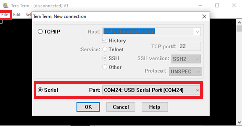
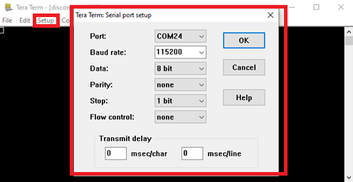
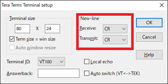
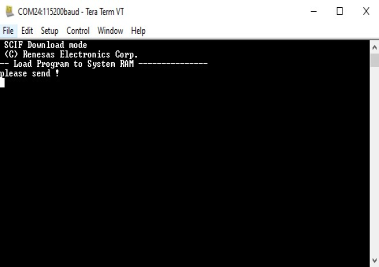
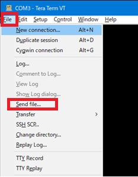

## Step 5: Reference Board Setting

### 1. Setup EVK's peripheral

Please setup following below diagram.

=== "RZ/T2H"

    
    

=== "RZ/N2H"

    
    

=== "RZ/T2N"

    

### 2. EVK's DIP switch

=== "RZ/T2H"

    EVK's DIP switch (SW14) and jumper (CN77 and CN78) reference.

    * jumper

        <div class="grid cards" markdown>

        - **SD Card (CN77)**

            ---

            

        - **eMMC (CN78)**

            ---

            

        </div>

    * SW14

        <div class="grid cards cards-fullwidth" markdown>

        - **SCIF Download Mode**

            ---

            !!! content-wrapper no-indent table-no-sort table-no-hover ""

                |     SW14-1     |     SW14-2     |     SW14-3     |     SW14-4     |     SW14-5     |     SW14-6     |     SW14-7     |     SW14-8     |
                |:--------------:|:--------------:|:--------------:|:--------------:|:--------------:|:--------------:|:--------------:|:--------------:|
                |  OFF {: .red}  | ON {: .green } |  OFF {: .red}  |  OFF {: .red}  |  OFF {: .red}  | ON {: .green } | ON {: .green } |  OFF {: .red}  |

        - **xSPI Boot Mode**

            ---

            !!! content-wrapper no-indent table-no-sort table-no-hover ""

                |     SW14-1     |     SW14-2     |     SW14-3     |     SW14-4     |     SW14-5     |     SW14-6     |     SW14-7     |     SW14-8     |
                |:--------------:|:--------------:|:--------------:|:--------------:|:--------------:|:--------------:|:--------------:|:--------------:|
                | ON {: .green } | ON {: .green } | ON {: .green } |  OFF {: .red}  |  OFF {: .red}  |  OFF {: .red}  | ON {: .green } |  OFF {: .red}  |

        - **eMMC Boot Mode**

            ---

            !!! content-wrapper no-indent table-no-sort table-no-hover ""

                |     SW14-1     |     SW14-2     |     SW14-3     |     SW14-4     |     SW14-5     |     SW14-6     |     SW14-7     |     SW14-8     |
                |:--------------:|:--------------:|:--------------:|:--------------:|:--------------:|:--------------:|:--------------:|:--------------:|
                | ON {: .green } | ON {: .green } |  OFF {: .red}  |  OFF {: .red}  |  OFF {: .red}  | ON {: .green } | ON {: .green } |  OFF {: .red}  |

        - **eSD Boot Mode**

            ---

            !!! content-wrapper no-indent table-no-sort table-no-hover ""

                |     SW14-1     |     SW14-2     |     SW14-3     |     SW14-4     |     SW14-5     |     SW14-6     |     SW14-7     |     SW14-8     |
                |:--------------:|:--------------:|:--------------:|:--------------:|:--------------:|:--------------:|:--------------:|:--------------:|
                |  OFF {: .red}  |  OFF {: .red}  | ON {: .green } |  OFF {: .red}  |  OFF {: .red}  |  OFF {: .red}  | ON {: .green } |  OFF {: .red}  |

        </div>

=== "RZ/N2H"

    EVK's DIP switch (DSW3) and jumper (JP23) reference.

    * jumper

        <div class="grid cards" markdown>

        - **eMMC (JP23)**

            ---

            

        </div>

    * DSW3

        <div class="grid cards cards-fullwidth" markdown>

        - **SCIF Download Mode**

            ---

            !!! content-wrapper no-indent table-no-sort table-no-hover ""


                |     DSW3-1     |     DSW3-2     |     DSW3-3     |     DSW3-4     |     DSW3-5     |     DSW3-6     |     DSW3-7     |     DSW3-8     |
                |:--------------:|:--------------:|:--------------:|:--------------:|:--------------:|:--------------:|:--------------:|:--------------:|
                |  OFF {: .red}  | ON {: .green } |  OFF {: .red}  |  OFF {: .red}  |  OFF {: .red}  |  OFF {: .red}  | ON {: .green } |  OFF {: .red}  |

        - **xSPI Boot Mode**

            ---

            !!! content-wrapper no-indent table-no-sort table-no-hover ""


                |     DSW3-1     |     DSW3-2     |     DSW3-3     |     DSW3-4     |     DSW3-5     |     DSW3-6     |     DSW3-7     |     DSW3-8     |
                |:--------------:|:--------------:|:--------------:|:--------------:|:--------------:|:--------------:|:--------------:|:--------------:|
                | ON {: .green } | ON {: .green } | ON {: .green } |  OFF {: .red}  |  OFF {: .red}  |  OFF {: .red}  | ON {: .green } |  OFF {: .red}  |

        - **eMMC Boot Mode**

            ---

            !!! content-wrapper no-indent table-no-sort table-no-hover ""


                |     DSW3-1     |     DSW3-2     |     DSW3-3     |     DSW3-4     |     DSW3-5     |     DSW3-6     |     DSW3-7     |     DSW3-8     |
                |:--------------:|:--------------:|:--------------:|:--------------:|:--------------:|:--------------:|:--------------:|:--------------:|
                | ON {: .green } | ON {: .green } |  OFF {: .red}  |  OFF {: .red}  |  OFF {: .red}  | ON {: .green } | ON {: .green } |  OFF {: .red}  |

        - **eSD Boot Mode**

            ---

            !!! content-wrapper no-indent table-no-sort table-no-hover ""


                |     DSW3-1     |     DSW3-2     |     DSW3-3     |     DSW3-4     |     DSW3-5     |     DSW3-6     |     DSW3-7     |     DSW3-8     |
                |:--------------:|:--------------:|:--------------:|:--------------:|:--------------:|:--------------:|:--------------:|:--------------:|
                |  OFF {: .red}  |  OFF {: .red}  | ON {: .green } |  OFF {: .red}  |  OFF {: .red}  |  OFF {: .red}  | ON {: .green } |  OFF {: .red}  |

        </div>

=== "RZ/T2N"

    EVK's DIP switch and jumper reference.

    * jumper

        <div class="grid cards" markdown>

        - **microSD Card (J25)**

            ---

            !!! content-wrapper no-indent table-no-sort table-no-hover ""

                { align=left .switch-icon }

                |      J25 1-2      |      J25 3-4      |
                |:-----------------:|:-----------------:|
                |   OPEN {: .red}   |  SHORT {: .green} |

        - **eMMC (J39)**

            ---

            !!! content-wrapper no-indent table-no-sort table-no-hover ""

                { align=left .switch-icon }

                |      J39 2-3      |      J39 1-2      |
                |:-----------------:|:-----------------:|
                |   OPEN {: .red}   |  SHORT {: .green} |


        </div>

    * SW7

        <div class="grid cards" markdown>


        - **microSD Card**

            ---


            !!! content-wrapper no-indent table-no-sort table-no-hover ""

                |      SW7-1     |
                |:--------------:|
                | ON {: .green}  |

        - **eMMC**

            ---


            !!! content-wrapper no-indent table-no-sort table-no-hover ""

                |      SW7-7     |      SW7-8     |
                |:--------------:|:--------------:|
                | ON {: .green}  | ON {: .green } |

        </div>

    * MODE (BOOT) SW8

        <div class="grid cards cards-fullwidth" markdown>

        - **SCIF Download Mode**

            ---

            !!! content-wrapper no-indent table-no-sort table-no-hover ""


                |      SW8-1     |      SW8-2     |      SW8-3     |      SW8-4     |
                |:--------------:|:--------------:|:--------------:|:--------------:|
                |  OFF {: .red}  | ON {: .green } |  OFF {: .red}  |  OFF {: .red}  |

    * MODE (BOOT) SW8

        <div class="grid cards cards-fullwidth" markdown>

        - **SCIF Download Mode**

            ---

            !!! content-wrapper no-indent table-no-sort table-no-hover ""


                |      SW8-1     |      SW8-2     |      SW8-3     |      SW8-4     |
                |:--------------:|:--------------:|:--------------:|:--------------:|
                |  OFF {: .red}  | ON {: .green } |  OFF {: .red}  |  OFF {: .red}  |

        - **xSPI Boot Mode**

            ---

            !!! content-wrapper no-indent table-no-sort table-no-hover ""


                |      SW8-1     |      SW8-2     |      SW8-3     |      SW8-4     |
                |:--------------:|:--------------:|:--------------:|:--------------:|
                | ON {: .green } | ON {: .green } | ON {: .green } |  OFF {: .red}  |

        - **eMMC Boot Mode**

            ---

            !!! content-wrapper no-indent table-no-sort table-no-hover ""


                |      SW8-1     |      SW8-2     |      SW8-3     |      SW8-4     |
                |:--------------:|:--------------:|:--------------:|:--------------:|
                | ON {: .green } | ON {: .green } |  OFF {: .red}  |  OFF {: .red}  |

        - **eSD Boot Mode**

            ---

            !!! content-wrapper no-indent table-no-sort table-no-hover ""


                |      SW8-1     |      SW8-2     |      SW8-3     |      SW8-4     |
                |:--------------:|:--------------:|:--------------:|:--------------:|
                |  OFF {: .red}  |  OFF {: .red}  | ON {: .green } |  OFF {: .red}  |

        </div>

### 3. Prepare for Flashing Boot Loader into EVK

Connect the board to the programing PC by using the USB serial cable.

1. To set the board to SCIF Download mode, set the switch as below.

    === "RZ/T2H"

        !!! content-wrapper no-indent table-no-sort table-no-hover ""

            |     SW14-1     |     SW14-2     |     SW14-3     |     SW14-4     |     SW14-5     |     SW14-6     |     SW14-7     |     SW14-8     |
            |:--------------:|:--------------:|:--------------:|:--------------:|:--------------:|:--------------:|:--------------:|:--------------:|
            |  OFF {: .red}  | ON {: .green } |  OFF {: .red}  |  OFF {: .red}  |  OFF {: .red}  | ON {: .green } | ON {: .green } |  OFF {: .red}  |

    === "RZ/N2H"

        !!! content-wrapper no-indent table-no-sort table-no-hover ""

            |     DSW3-1     |     DSW3-2     |     DSW3-3     |     DSW3-4     |     DSW3-5     |     DSW3-6     |     DSW3-7     |     DSW3-8     |
            |:--------------:|:--------------:|:--------------:|:--------------:|:--------------:|:--------------:|:--------------:|:--------------:|
            |  OFF {: .red}  | ON {: .green } |  OFF {: .red}  |  OFF {: .red}  |  OFF {: .red}  |  OFF {: .red}  | ON {: .green } |  OFF {: .red}  |

    === "RZ/T2N"

        !!! content-wrapper no-indent table-no-sort table-no-hover ""

            |      SW8-1     |      SW8-2     |      SW8-3     |      SW8-4     |
            |:--------------:|:--------------:|:--------------:|:--------------:|
            |  OFF {: .red}  | ON {: .green } |  OFF {: .red}  |  OFF {: .red}  |

2. Turn ON the power switch to supply the power.

    === "RZ/T2H"

        * Power switch: SW16

    === "RZ/N2H"

        * Power switch: SW1

    === "RZ/T2N"

        * Power switch: SW1

3. Bring up **TeraTerm** and select the **File** > **New Connection** to set the connection on the software.

    

4. Select the **Setup** > **Serial port** to set the settings about serial communication protocol on **TeraTerm**.

    Set the settings for the serial communication in **TeraTerm** as below:

    !!! content-wrapper no-indent table-no-sort table-no-hover ""

        |   Variable   |        Value          |
        |:------------:|:----------------------|
        | Baud rate    | `#!bash 115200` bps   |
        | Data         | `#!bash 8 bit`        |
        | Parity       | `#!bash none`         |
        | Stop         | `#!bash 1 bit`        |
        | Flow control | `#!bash none`         |

    

5. Select the **Setup** > **Terminal** to set the new-line code.

    !!! content-wrapper no-indent table-no-sort table-no-hover ""

        |   Variable   |             Value              |
        |:------------:|:-------------------------------|
        | New-line     | `#!bash CR` or `#!bash AUTO`   |

    

6. After finishing all settings, when the reset button is pressed, the message below will be displayed on the terminal.

    

### 4. Download Flash Programmer to RAM

Flash Programmer is a small program that is downloaded into internal RAM inside the target device to assist in programming the boot loader into Flash memory.

Turn on the power of the board. The messages below are shown on the terminal.

``` console
 SCI Download mode (Normal SCI boot)
```

Send an image of `#!bash Flash Programmer` using the terminal software after the message **please send !** is shown.

`#!bash Flash Programmer` image file is:

=== "RZ/T2H"

    * `#!bash HDR NM` (firstly send)
    * `#!bash Flash_Programmer_SCIF_CR52_RZT2H_EVK.mot` (secondary send)

=== "RZ/N2H"

    * `#!bash HDR NM` (firstly send)
    * `#!bash Flash_Programmer_SCIF_CR52_RZT2H_EVK.mot` (secondary send)

=== "RZ/T2N"

    * `#!bash HDR NM` (firstly send)
    * `#!bash Flash_Programmer_SCIF_CR52_RZT2N_EVK.mot` (secondary send)


Below is a sample procedure with **TeraTerm**.

1. Open a **Send file** dialog by selecting **File** > **Send file** menu.

    

    

2. Select the image to be send and click **Open** button in the Tera Term: Send file dialog box.

3. The image will be sent to the board via serial connection.

    

    === "RZ/T2H"

        !!! danger "Caution"

            When the transfer is complete, please transfer the file of `Flash_Programmer_SCIF_CR52_RZT2H_EVK.mot` using the same procedure within 30 seconds.

            If not completed within 10 seconds, please restart the transfer from the `HDR NM` file.

    === "RZ/N2H"

        !!! danger "Caution"

            When the transfer is complete, please transfer the file of `Flash_Programmer_SCIF_CR52_RZT2H_EVK.mot` using the same procedure within 30 seconds.

            If not completed within 10 seconds, please restart the transfer from the `HDR NM` file.

    === "RZ/T2N"

        !!! danger "Caution"

            When the transfer is complete, please transfer the file of `Flash_Programmer_SCIF_CR52_RZT2N_EVK.mot` using the same procedure within 30 seconds.

            If not completed within 10 seconds, please restart the transfer from the `HDR NM` file.

4. After successfully downloading the binary, `#!bash Flash Programmer` starts automatically and shows a message like below on the terminal.

    === "RZ/T2H"

        ``` console
        SCI Download mode (Normal SCI boot)
        -- Load Program to RAM ---------------
        -- Start Boot Program on RAM ---------

        Flash Programmer V1.06 (RZT2H)(CR52)
        ```

    === "RZ/N2H"

        ``` console
        SCI Download mode (Normal SCI boot)
        -- Load Program to RAM ---------------
        -- Start Boot Program on RAM ---------

        Flash Programmer V1.06 (RZT2H)(CR52)
        ```

    === "RZ/T2N"

        ``` console
        SCI Download mode (Normal SCI boot)
        -- Load Program to RAM ---------------
        -- Start Boot Program on RAM ---------

        Flash Programmer V1.20 (RZT2N)(CR52)
        ```

### 5. Write the Bootloader

For the boot operation, two boot loader files need to be programming into the target board.

The corresponding bootloader files and specified address information depend on each target board.

use the `#!bash XSPIW` command of Flash Programmer to write boot loader binary files.

This command receives binary data from the serial port and writes the data to a specified address of the Flash ROM with information where the data should be loaded on the address of the main memory.

=== "RZ/T2H"

    For example, this part describes how to write boot loader files:

    ``` console
    > XSPIW 0 0 0
    send file
    ```

    Send the data of `#!bash bl2_bp_xspi0-rzt2h-dev.srec` from terminal software after the message **send file** is shown.

    After successfully downloading the binary, messages like below are shown on the terminal.

    ``` console
    Erased
    Writen
    ```

    Next, write another loader file by using `#!bash XSPIW` command again.

    ``` console
    > XSPIW 0 0x060000 0
    send file
    ```

    Send the data of `#!bash fip-rzt2h-dev.srec` from terminal software after the message **send file** is shown.

    After successfully downloading the binary, messages like below are shown on the terminal.

    ``` console
    Erased
    Writen
    ```

    At last, turn off the power of the board.

=== "RZ/N2H"

    For example, this part describes how to write boot loader files:

    ``` console
    > XSPIW 0 0 0
    send file
    ```

    Send the data of `#!bash bl2_bp_xspi0-rzn2h-dev.srec` from terminal software after the message **send file** is shown.

    After successfully downloading the binary, messages like below are shown on the terminal.

    ``` console
    Erased
    Writen
    ```

    Next, write another loader file by using `#!bash XSPIW` command again.

    ``` console
    > XSPIW 0 0x060000 0
    send file
    ```

    Send the data of `#!bash fip-rzn2h-dev.srec` from terminal software after the message **send file** is shown.

    After successfully downloading the binary, messages like below are shown on the terminal.

    ``` console
    Erased
    Writen
    ```

    At last, turn off the power of the board.


=== "RZ/T2N"

    For example, this part describes how to write boot loader files:

    ``` console
    > XSPIW 0 0 0
    send file
    ```

    Send the data of `#!bash bl2_bp_xspi0-rzt2n-dev.srec` from terminal software after the message **send file** is shown.

    After successfully downloading the binary, messages like below are shown on the terminal.

    ``` console
    Erased
    Writen
    ```

    Next, write another loader file by using `#!bash XSPIW` command again.

    ``` console
    > XSPIW 0 0x060000 0
    send file
    ```

    Send the data of `#!bash fip-rzt2n-dev.srec` from terminal software after the message **send file** is shown.

    After successfully downloading the binary, messages like below are shown on the terminal.

    ``` console
    Erased
    Writen
    ```

    At last, turn off the power of the board.